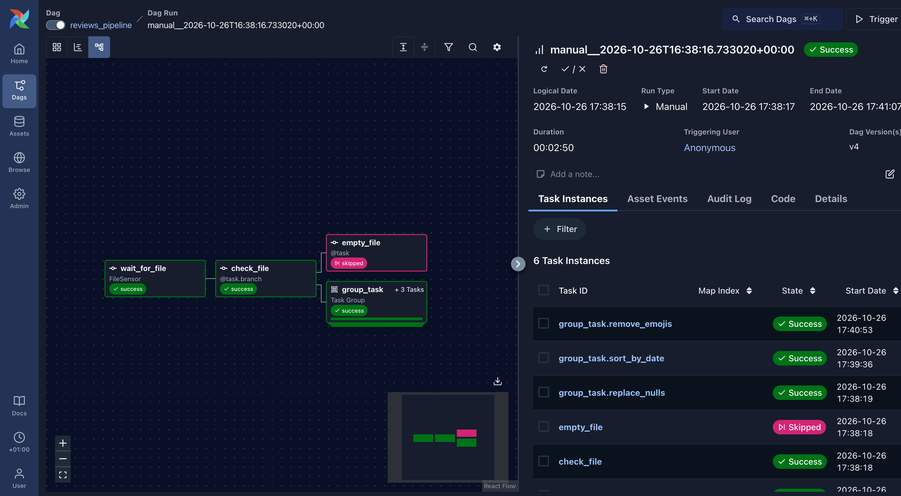
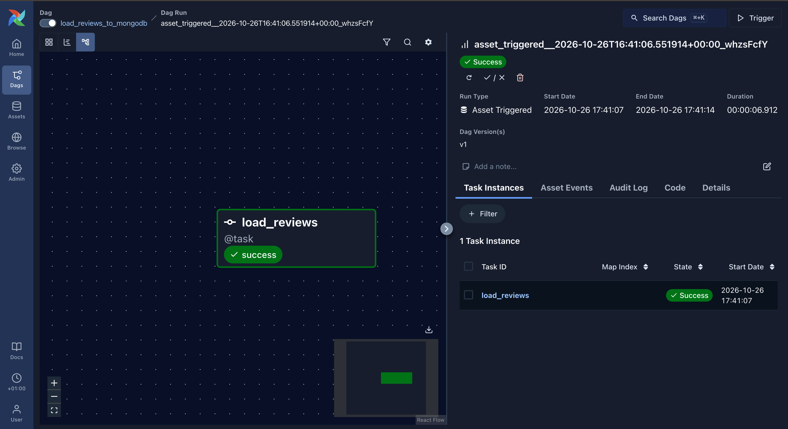

# Airflow Reviews Pipeline

## Architecture

The project processes app reviews using Apache Airflow,
Pandas and MongoDB.

## DAG 1 — Reviews Processing

Waits for the input CSV, replaces null values,
sorts reviews by date and cleans the comment text.

## DAG 2 — MongoDB Loading

Triggered by an updated Airflow Asset.
Loads the processed CSV into MongoDB.

